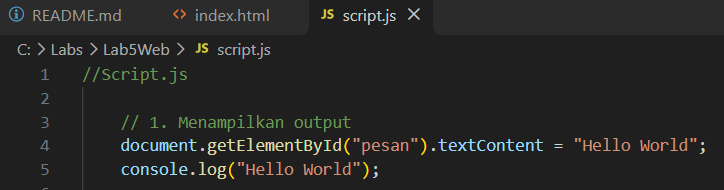
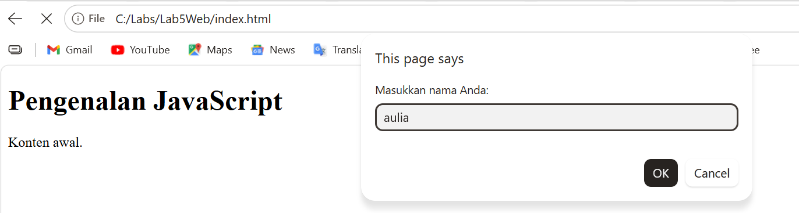
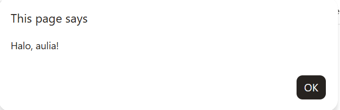

# Lab5Web

## JavaScript Dasar dan Manipulasi HTML
JavaScript adalah bahasa pemrograman yang banyak digunakan untuk mengatur perilaku halaman web.
JavaScript dapat mengubah konten HTML, nilai atribut, gaya CSS, serta menampilkan atau menyembunyikan elemen.

### 1. Menampilkan output
buat file dengan nama *script.js* 

