# Lab5Web

## JavaScript Dasar dan Manipulasi HTML
JavaScript adalah bahasa pemrograman yang banyak digunakan untuk mengatur perilaku halaman web.
JavaScript dapat mengubah konten HTML, nilai atribut, gaya CSS, serta menampilkan atau menyembunyikan elemen.

### 1. Menampilkan output
Buat file baru dengan nama *script.js* 

### 2. Alert dan prompt
Alert ==> Menampilkan pesan dan menunggu pengguna untuk menekan tombol "OK"

Prompt ==> Menerima 2 argumen

Menguji dengan memasukkan nama, menekan Cancel, dan membiarkan input kosong.

Tambahkan di file *script.js*
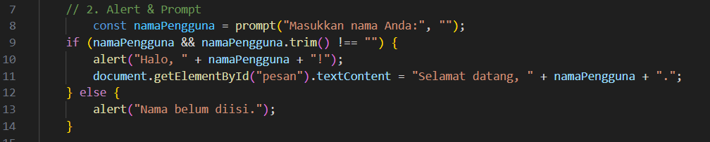

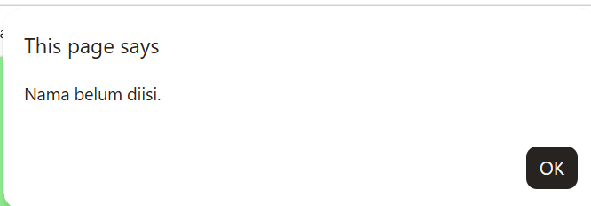

### 3. Function dan operasi aritmatika
Menampilkan hasil penjumlahan, pengurangan, perkalian, pembagian, dan sisa bagi.

Tambahkan di file *script.js*
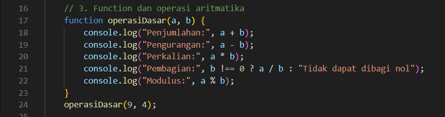

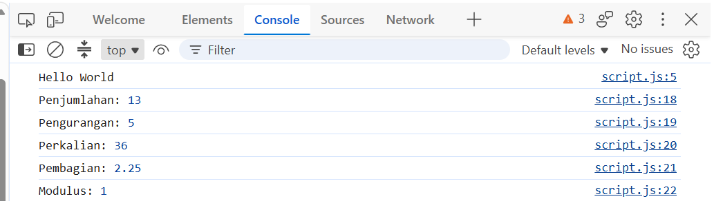

### 4. Seleksi kondisi if–else
If-Else adalah struktur logika dasar yang digunakan 
untuk membuat percabangan program. 

Tambahkan di file *script.js*
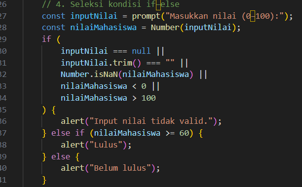

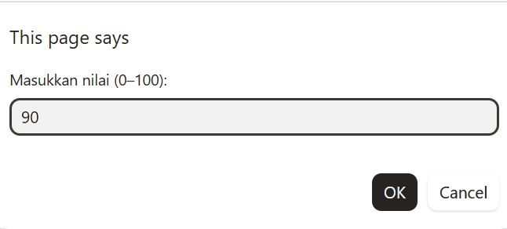

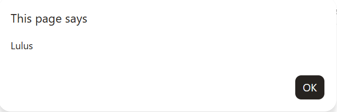

### 5. Seleksi kondisi Switch
Switch adalah bentuk percabangan dimana membandingkan **satu nilai yang sama** 
terhadap banyak kemungkinan nilai tetap.

Tambahkan di file *script.js*
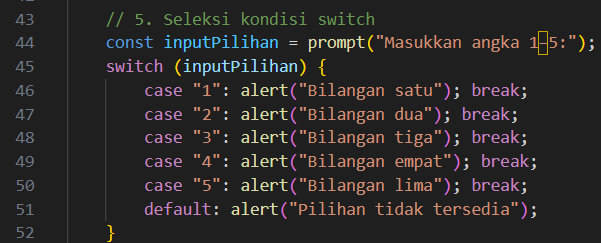

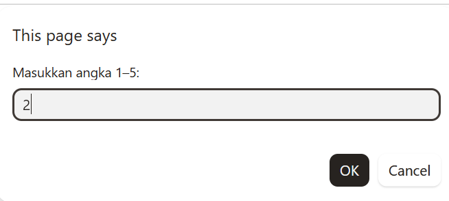 

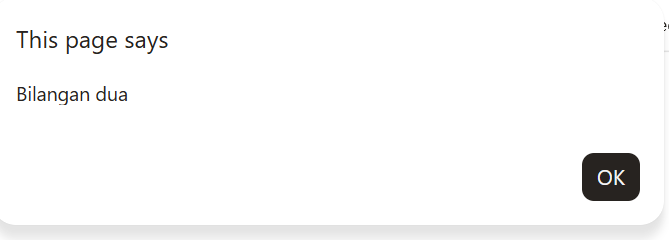

### 6. Form bilangan genap atau ganjil
Tambahkan form di body **index.html** 
Saat tombol ditekan, program memeriksa bilangan 
dan menampilkan apakah bilangan genap atau ganjil.
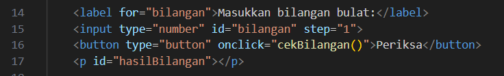

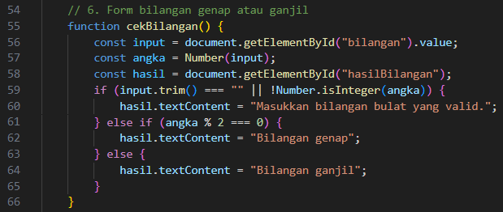

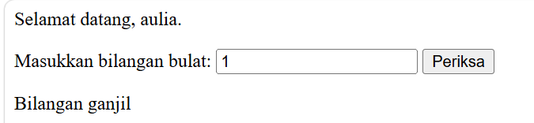

### 7. Mengubah warna halaman
Membuat tiga tombol yang mengubah warna latar halaman.
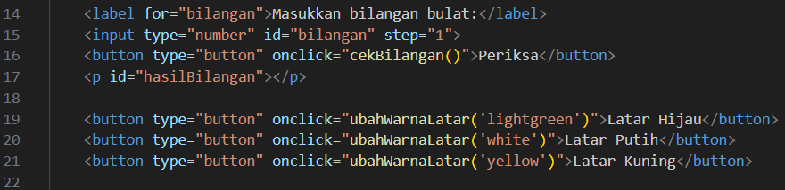

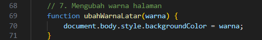

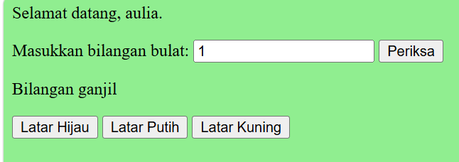

### 8. DOM dan checkbox menu makanan
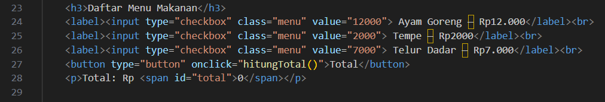

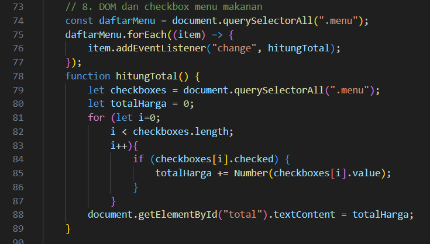

### 9. Mini Project — Kalkulator Nilai Mahasiswa
Membuat kalkulator sederhana
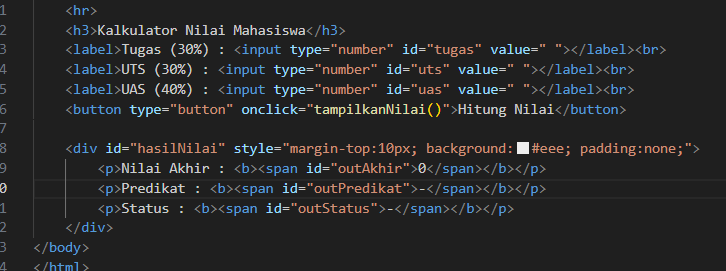

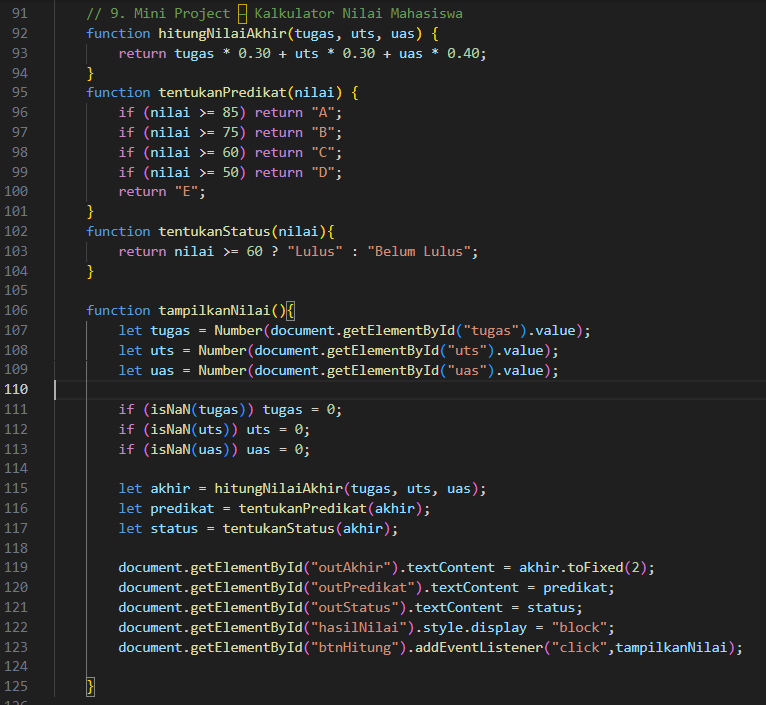

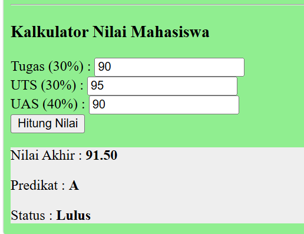